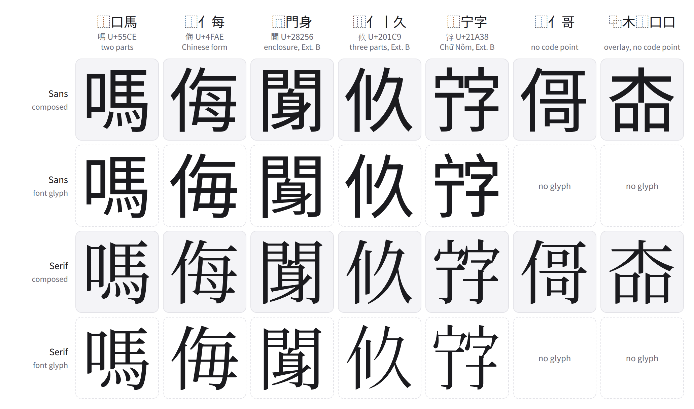

# han-compose

han-compose draws a Han character from its ideographic description sequence (IDS), such as
`⿰亻哥`, as font outlines. Use it to draw a character no font has, one with no code point, or a
regional form the font does not draw. Each part comes from a character the font already draws,
cut out of it (along KanjiVG's component groups where KanjiVG has that kanji), set where the
font's designers put parts like it, and brought to one stroke weight. The result is an SVG path in
a 1000-unit em, in a sans style from Noto Sans CJK JP, whose ideographs GenZui Sans takes unchanged;
a serif (明朝) style from Noto Serif CJK JP; or a kaisho (楷書) style from Kureedo, the Klee One
design extended with historical kana. Plangothic supplies the sans parts Noto lacks, Jigmo the serif
ones, and GenZui Sans the characters Kureedo lacks.

<picture>
  <source media="(prefers-color-scheme: dark)" srcset="docs/images/composed-dark.png">
  
</picture>

Each composed glyph above is drawn from its sequence with the character's own glyph left out; the
row below it is the font's glyph. 侮 is composed in the Chinese form, ⿰亻每, while the Japanese
font draws ⿰亻毎. Composed glyphs that use KanjiVG cuts are CC BY-SA 3.0 (see [Sources](#sources)),
so the image is shared under CC BY-SA 3.0.

han-compose lays out ⿰ ⿱ ⿲ ⿳, the enclosures ⿴ to ⿺, and the overlay ⿻. It does not draw ⿼ ⿽ ⿾
⿿ ㇯ or 〾, and its fonts have no Tangut. Chữ Nôm characters are Han characters and are drawn like
any other.

## Run

```sh
uv sync
uv run scripts/compose_ids.py draw ⿰亻哥 > 亻哥.svg
uv run scripts/compose_ids.py bench --chars joyo
uv run scripts/compose_ids.py draw --style serif ⿰亻哥 > 亻哥-serif.svg
uv run scripts/compose_ids.py draw --style kaisho ⿰亻哥 > 亻哥-kaisho.svg
uv run scripts/compose_ids.py draw-many sequences.txt out/
```

`draw-many` draws every sequence in a file, one a line, into `out/` as `<sha256 of its NFC form>.svg`,
and lists those it cannot draw.

Every command takes `--style sans` (the default), `--style serif` or `--style kaisho`. Each style
has its own fonts and models: a style's model is cached as `<name>-<style><ext>` beside the sans
one, and `learn --style kaisho` and `learn-alone --style kaisho` build it. Kureedo is static, so the
Kaisho style keeps the source brush weights instead of balancing them.

`bench` redraws every compound jōyō kanji from its own sequence with nothing taken from the
character, and scores each against the font's real glyph: the overlap of their ink (intersection
over union, at 96 px), how many come out with their outline length within 15% of the real glyph's,
and the ratio of their stroke widths. `draw` accepts any sequence, including one no character is
encoded for.

Drawing needs two models under `cache/`, which `learn` and `learn-alone` build from the font itself
and need `uv sync --extra train`:

```sh
uv run --extra train scripts/compose_ids.py learn
uv run --extra train scripts/compose_ids.py learn-alone
```

Drawing with the guide needs `onnxruntime`, and training needs `torch`. `uv sync --all-extras --group dev`
keeps both: syncing one extra alone drops the other.

`export-web` writes what a browser port of the composer reads: the learned layout, the records of
every character and sequence and the host lists of every place and operand, a manifest with the
composer's version, its constants and the licence notices, and the licence texts. Records and host
lists are packed into gzipped shards named by the first three hex digits of their SHA-256
(`g/<hhh>.json`, `p/<hhh>.json`, at most 4,096 each), each a JSON object from the full hash to the
record or list, so a page loads only the shards a sequence names. `--parity N` adds N reference
drawings of compound jōyō kanji whose hosts join the export, and `--held-out M` M more whose hosts
do not, for the port's parity test.

Workers write one file per record and host list under `out/.work/`, which a stopped run resumes
from, and the export builds the shards from them at the end. `export-web-pack` builds the shards
again from a finished folder's `.work/`, and brings its manifest, parity files and `.export` stamp
to format 5, so a format-4 folder whose `g/` and `p/` are moved under `.work/` becomes the folder
a format-5 export writes. A rerun resumes from `.work/` only under the same version, which names
the commit: from another commit `export-web` starts afresh.

Records hold every letter and digit of an alphabet or syllabary the style's fonts draw (Latin,
IPA, Greek, Cyrillic, kana, Hangul, the full- and half-width forms), so a sequence such as
`⿸广⿰KO` draws in a port. `export-web OUT --add letters` writes those records into a finished
folder made before they were part of the export, after checking that the folder's fonts, layout and
KanjiVG are the ones in use and that this commit records 40 of the folder's characters exactly as
the folder holds them. `export-web-pack` then rebuilds only the shards the new records fall in,
and the folder takes a new version, the old one with `+letters` after it, in its manifest, parity
files, `.export` and `.complete`: ports serve the files immutable by URL, so changed bytes need a
new name, and the folder is uploaded whole under it. The manifest's `added` names the commit, the
set, the count and the shards changed. Adding the same set again keeps the name. `--dry-run`
reports how many keys and shards an addition would take and writes nothing.

`.work/` must never be uploaded: each of its files would be one more object written. Exclude it
when copying the folder out:

```sh
uv run scripts/compose_ids.py export-web out/ --parity 500 --held-out 300 --workers 4
uv run scripts/compose_ids.py export-web-pack out/
rclone copy out/ <remote>:<bucket>/<version>/ --exclude '.work/**'
```

Fonts download to `cache/fonts/` on first use. `$HAN_COMPOSE_CACHE` points the cache elsewhere.
`COMPOSE_GUIDE` points at a folder of `guide-*.onnx`.

## Layout

| Path | |
|---|---|
| `src/han_compose/compose.py` | the composer: hosts, cuts, layout, weight |
| `src/han_compose/compose_layout.py` | where a character's two operands go, learned from the font |
| `src/han_compose/compose_standalone.py` | the size a part takes when it stands alone |
| `src/han_compose/kanjivg_cuts.py` | cutting a host along KanjiVG's component groups |
| `src/han_compose/vocab.py` | the vocab tables and the cache |
| `src/han_compose/web_export.py` | the layout and drawing data for a browser port |
| `scripts/compose_ids.py` | `draw`, `draw-many`, `bench`, `calibrate`, `learn`, `learn-alone`, `export-web`, `export-web-pack` |
| `tests/` | tests over cutting, layout, drawn output and the web export |
| `docs/design/ids-composer.md` | the method, its measurements, and what did not help |

## Sources

`docs/licensing.md` states what the code, the fonts and the tables are under. In short: Noto Sans CJK
JP and Plangothic (SIL OFL 1.1) supply every sans outline, Noto Serif CJK JP (SIL OFL 1.1) and Jigmo
(CC0 1.0) every serif one; BabelStone IDS and cjkvi-variants supply the
sequences and the radical forms; hfhchan/ids (MIT) supplies the list of ideographs left
undecomposed; KanjiVG (CC BY-SA 3.0) supplies component ownership when a host is cut. Glyphs drawn
from KanjiVG-assisted cuts are shared alike, with its notice kept. The `export-web` manifest carries
the same notices for the data it writes.
