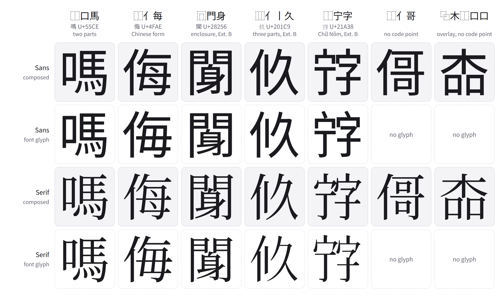

# han-compose

han-compose draws a Han character from its ideographic description sequence (IDS), such as
`⿰亻哥`, as font outlines. Use it to draw a character no font has, one with no code point, or a
regional form the font does not draw. Each part comes from a character the font already draws,
cut out of it (along KanjiVG's component groups where KanjiVG has that kanji), set where the
font's designers put parts like it. The sans and serif styles then bring the parts to one stroke weight;
woodblock grows each part's strokes from its one weight to do the same; fangsong, regular and pen-writing keep the weight each part has in its font. The result is an SVG path in
a 1000-unit em, in a sans style from Noto Sans CJK JP, whose ideographs GenZui Sans takes unchanged;
a serif (明朝) style from Noto Serif CJK JP; a woodblock (刻本明體) style from Nôm Na Tống alone; a fangsong (仿宋) style from Zhuque Fangsong; a regular
(正楷) style from TW-Kai, the CNS 11643 Kai, whose Extension B and G faces draw what its BMP face
lacks; or a pen-writing (文楷) style from Kureedo Full, the Klee One design with historical kana and
LXGW WenKai Light for the characters Klee lacks. Plangothic supplies the sans parts Noto lacks, Jigmo
the serif ones and the ideographs Zhuque lacks, and GenZui Sans the characters Kureedo Full lacks.

<picture>
  <source media="(prefers-color-scheme: dark)" srcset="docs/images/composed-dark.png">
  
</picture>

Each composed glyph above is drawn from its sequence with the character's own glyph left out; the
row below it is the font's glyph. 侮 is composed in the Chinese form, ⿰亻每, while the Japanese
font draws ⿰亻毎. Composed glyphs that use KanjiVG cuts are CC BY-SA 3.0 (see [Sources](#sources)),
so the image is shared under CC BY-SA 3.0.

han-compose lays out ⿰ ⿱ ⿲ ⿳, the enclosures ⿴ to ⿺ and ⿼ ⿽, the overlay ⿻, the reflection ⿾
and the half-turn ⿿. The right-hand enclosures ⿼ and ⿽ use the enclosing outline's opening or a
default box when no opening is found; their placement is approximate and can differ substantially
from a designed glyph. 〾 draws its operand as it is. ㇯ leaves its second operand out of the
first: the first's glyph is cut along its sequence, or along KanjiVG's component groups, and the
outlines of that component are dropped (㇯鹿比); a lone stroke is the one stroke KanjiVG types so,
where the character has just one (㇯兵丶). Where none of these names it, the second operand is
drawn where it lies in the first and masked out of it. Marks written after a sequence are drawn
with it: a combining mark over or under the drawing (⿰木口́), a spacing accent, a kana voicing
mark or a superscript at its upper right (⿰木口¹). A Hangul syllable written as conjoining jamo
is one component: the syllable itself where a code point spells it, else its letters set as a
syllable sets them. Its fonts have no Tangut.
Chữ Nôm characters are Han characters and are drawn like
any other.

## Run

```sh
uv sync
uv run scripts/compose_ids.py draw ⿰亻哥 > 亻哥.svg
uv run scripts/compose_ids.py bench
uv run scripts/compose_ids.py draw --style serif ⿰亻哥 > 亻哥-serif.svg
uv run scripts/compose_ids.py draw --style woodblock ⿰亻哥 > 亻哥-woodblock.svg
uv run scripts/compose_ids.py draw --style fangsong ⿰亻哥 > 亻哥-fangsong.svg
uv run scripts/compose_ids.py draw --style regular ⿰亻哥 > 亻哥-regular.svg
uv run scripts/compose_ids.py draw --style pen-writing ⿰亻哥 > 亻哥-pen-writing.svg
uv run scripts/compose_ids.py draw-many sequences.txt out/
```

`draw-many` draws every sequence in a file, one a line, into `out/` as `<sha256 of its NFC form>.svg`,
and lists those it cannot draw.

Every command takes `--style sans` (the default), `--style serif`, `--style woodblock`, `--style fangsong`,
`--style regular` or `--style pen-writing`. Each style has its own fonts and models: a style's model is cached as
`<name>-<style><ext>` beside the sans one, and `learn --style regular` and `learn-alone --style regular`
build it. TW-Kai, Kureedo and Zhuque Fangsong are static brush faces, so their styles keep the source
stroke weights instead of balancing them. Nôm Na Tống is static too; its strokes are balanced by
growing its one weight.

`bench` redraws characters from their own sequences with nothing taken from them, and scores each
against the font's real glyph: the overlap of their ink (intersection over union, at 96 px), the same
with each drawing stretched to fill the raster, which scores the shape wherever it stands, how many
come out with their outline length within 15% of the real glyph's, and the ratio of their stroke
widths. By default it runs the benchmark sets in `data/bench/sets.json`, scored apart: `tracking`
estimates a style's average, and `hard` holds the characters that came out worst in every style, for
catching regressions. `--chars joyo` and `--chars all` run wider sets. `draw` accepts any sequence, including one no character is
encoded for.

Drawing needs two models under `cache/`, which `learn` and `learn-alone` build from the font itself
and need `uv sync --extra train`:

```sh
uv run --extra train scripts/compose_ids.py learn
uv run --extra train scripts/compose_ids.py learn-alone
```

The composer's mask and ring kernels are in Rust (`rust/`), so installing needs a Rust toolchain; `uv sync`
builds them.

Drawing with the guide needs `onnxruntime`, and training needs `torch`. `uv sync --all-extras --group dev`
keeps both: syncing one extra alone drops the other.

`export-web` writes what a browser port of the composer reads: the learned layout, the records of
every character and sequence and the host lists of every place and operand, a manifest with the
composer's version, its constants and the licence notices, and the licence texts. Records and host
lists are packed into gzipped shards named by the first hex digits of their SHA-256, each a JSON
object from the key to the record or list: four digits for a record (`g/<hh>/<hhhh>.json`, at most
65,536 shards of a few records each) and three for a host list (`p/<hhh>.json`, at most 4,096). A
drawing reads a few dozen records, each from another shard, so a small shard keeps it to little more
than the records it uses. `identity.json` holds every character's sequence and the character each
sequence describes, so a page finds what a description names without reading a record for each
spelling it tries. `--parity N` adds N reference
drawings of compound jōyō kanji whose hosts join the export, and `--held-out M` M more whose hosts
do not, for the port's parity test.

Workers write one file per record and host list under `out/.work/`, which a stopped run resumes
from, and the export builds the shards from them at the end. `export-web-pack` builds the shards
again from a finished folder's `.work/`, and brings its manifest, parity files and `.export` stamp
to format 7, so a format-6 folder, and a format-4 or format-5 folder whose `g/` and `p/` are moved
under `.work/`, becomes the folder a format-7 export writes. A rerun resumes from `.work/` only under the same version, which names
the commit: from another commit `export-web` starts afresh. Every host's glyph and KanjiVG
ownership are read once before the workers fork, and the workers share them. Host cutting releases
cut geometry after each batch of 64 records and at the end of each list. Every candidate, its rank and failed-cut
entry remain in the export; candidate selection depends on the character being composed.

Records hold every letter and digit of an alphabet or syllabary the style's fonts draw (Latin,
IPA, Greek, Cyrillic, kana, Hangul, the full- and half-width forms), so a sequence such as
`⿸广⿰KO` draws in a port. `export-web OUT --add letters` writes those records into a finished
folder made before they were part of the export, after checking that the folder's fonts, layout and
KanjiVG are the ones in use and that this commit records 40 of the folder's characters exactly as
the folder holds them. `export-web-pack` then rebuilds only the shards the new records fall in,
and the folder takes a new version, the old one with `+letters` after it, in its manifest, parity
files, `.export` and `.complete`: ports serve the files immutable by URL, so changed bytes need a
new name, and the folder is uploaded whole under it. The manifest's `added` names the commit, the
set, the count and the shards changed. Adding the same set again keeps the name. `--dry-run`
reports how many keys and shards an addition would take and writes nothing.

Records also hold every variation sequence the style's main font draws with a glyph of its own
(者 U+8005 U+E0101, the dotted 者), under the character and its selector, and `variants.json` lists
each character's selectors. `export-web OUT --add variants` writes them into a finished folder the
same way, and the folder's version gains `+variants`.

`kin.json` holds what drawing an enclosing part as its kin's reads beyond the host lists (麥's sweep
for ⿱𡗗夂 round 面 in Sans, Serif and Pen Writing): the kins of each lower part by place with their host counts, each kin's hosts
with its node cut along KanjiVG into an upper and a lower piece, and the upper parts cut from
characters holding an enclosing part on the left, each piece as indices of its host glyph's
contours. The export writes it from the host lists the folder holds. `export-web OUT --add kin`
writes it into a finished folder made before it, after the same checks of fonts, layout and
KanjiVG, and after checking that every host list it reads lists the hosts the composer's index
lists, in its order; it needs no `.work/`. `export-web-pack` publishes it, and the folder's version
gains `+kin`.

`.work/` must never be uploaded: each of its files would be one more object written. Exclude it
when copying the folder out:

```sh
uv run scripts/compose_ids.py export-web out/ --parity 500 --held-out 300 --workers 4
uv run scripts/compose_ids.py export-web-pack out/
uv run scripts/compose_ids.py redraw-parity out/ --style pen-writing   # the parity rows again, after a composer change
rclone copy out/ <remote>:<bucket>/<version>/ --exclude '.work/**'
```

Fonts download to `cache/fonts/` on first use. `$HAN_COMPOSE_CACHE` points the cache elsewhere.
`COMPOSE_GUIDE` points at a folder of `guide-*.onnx`.

## Variants

```sh
uv run scripts/compose_ids.py variants 釁 --style serif --out 釁/
```

`variants` writes the forms of one character into a folder: `variants.json`, each form with its
label, the text that selects it, its font, glyph and outline, and `variants.svg`, one sheet of them.
`--style` is `sans` or `serif`.

| Kind | Forms | Drawn from |
|---|---|---|
| `regional` | the character in Noto CJK's JP, KR, SC, TC and HK faces | the Regular collection of Noto Sans CJK 2.004 or Noto Serif CJK 2.002 |
| `ivs` | each sequence the Ideographic Variation Database of 2026-08-03 registers, with its collection and identifier (`Adobe-Japan1 CID+1481`) | the first font that maps the sequence: the collection's faces, IPAmj Mincho, Jigmo |
| `svs` | each sequence of Unicode 16.0.0's `StandardizedVariants.txt` | the same fonts |
| `compatibility` | each compatibility ideograph Unihan 16.0.0's `kCompatibilityVariant` gives the character | the first of those fonts that maps its code point |

The regional forms are Noto's own designs for each region, labelled with the face's name. They are
not the IRG source glyphs of the Unicode code charts. `irg_sources` lists the character's
`kIRG_*Source` values from Unihan as data, and no drawing is a source's glyph.

A form whose outline an earlier form already has is kept in the JSON with `same_as`, that form's
label. The sheet names it beneath the earlier form, and `--all` draws it as well. Outlines are
compared exactly, in a 1000-unit em, so two fonts' drawings of one shape stay apart. A registered
sequence no font maps is listed with `"outline": null`. `glyph` is the font's own glyph name: Noto's
`cid` numbers count its own glyphs, not Adobe-Japan1's.

Given a sequence, `variants` composes it once for each way to write its components with the
variation sequences the style's font draws with a glyph of their own, in any style:

```sh
uv run scripts/compose_ids.py variants ⿰氵者 --out 氵者/
```

Each drawing is labelled by the components it writes with a selector (`者 Adobe-Japan1 CID+13349`),
a component the sequence holds more than once with its place among the components (`者[5]`), and
`parts` lists where the composer took each part from. At most 24 ways are drawn; `combinations`
gives how many there are.

The Noto collection is read from `cache/fonts/`, else from `/usr/share/fonts/opentype/noto/`, where
Debian's `fonts-noto-cjk` installs it. It is checked against that package's digest and never
downloaded. IPAmj Mincho, Jigmo and the data files download on first use. `docs/licensing.md` lists
each input with its URL, digest and terms.

## Checks

```sh
uv run pytest tests -q
uv run ruff check
```

`ruff check` lints the Python; the repository is not formatted with `ruff format`.

## Layout

| Path | |
|---|---|
| `src/han_compose/compose.py` | the composer: hosts, cuts, layout, weight |
| `src/han_compose/compose_layout.py` | where a character's two operands go, learned from the font |
| `src/han_compose/compose_standalone.py` | the size a part takes when it stands alone |
| `src/han_compose/kanjivg_cuts.py` | cutting a host along KanjiVG's component groups |
| `src/han_compose/vocab.py` | the vocab tables and the cache |
| `src/han_compose/variants.py` | a character's regional designs, variation sequences and compatibility ideographs |
| `src/han_compose/web_export.py` | the layout and drawing data for the browser engine |
| `scripts/compose_ids.py` | `draw`, `draw-many`, `variants`, `bench`, `calibrate`, `learn`, `learn-alone`, `export-web`, `export-web-pack` |
| `tests/` | tests over cutting, layout, drawn output and the web export |
| `js/` | `han-compose`, the same composer in the browser, with its own tests |
| `data/` | the vocab tables, and the outlines the engine draws a part from when no export has it |
| `docs/design/ids-composer.md` | the method, its measurements, and what did not help |
| `docs/design/browser-composer.md` | the browser engine, and where the editor it serves meets it |
| `docs/design/stroke-weight.md` | how parts are brought to one stroke weight, and what a new font needs for it |

## Sources

`docs/licensing.md` states what the code, the fonts and the tables are under. In short: Noto Sans CJK
JP and Plangothic (SIL OFL 1.1) supply every sans outline, Noto Serif CJK JP (SIL OFL 1.1) and Jigmo
(CC0 1.0) every serif one, Nôm Na Tống (MIT) every woodblock one, TW-Kai (Open Government Data License 1.0) every regular one; BabelStone IDS and cjkvi-variants supply the
sequences and the radical forms; editorial sequences replace a BabelStone sequence that draws the
character wrongly ([`data/vocab/han-ids-drawn.tsv`](data/vocab/han-ids-drawn.tsv));
hfhchan/ids (MIT) supplies the list of ideographs left
undecomposed; KanjiVG (CC BY-SA 3.0) supplies component ownership when a host is cut. Glyphs drawn
from KanjiVG-assisted cuts are shared alike, with its notice kept. The `export-web` manifest carries
the same notices for the data it writes.

[KAGE](https://github.com/kamichikoichi/kage-engine), created by Koichi Kamichi, and the
[GlyphWiki](https://glyphwiki.org/) contributors developed a system for drawing characters from
reusable strokes and components. Their work is a predecessor to character composition here. The
serif style also uses [Jigmo](https://kamichikoichi.github.io/jigmo/), generated with KAGE from
GlyphWiki glyph data and released under CC0 1.0, for parts Noto Serif CJK does not draw; the fangsong
style uses it the same way for ideographs [Zhuque Fangsong](https://github.com/TrionesType/zhuque)
does not draw. The woodblock style reads [Nôm Na Tống](https://github.com/nomfoundation/font) and no other font.
