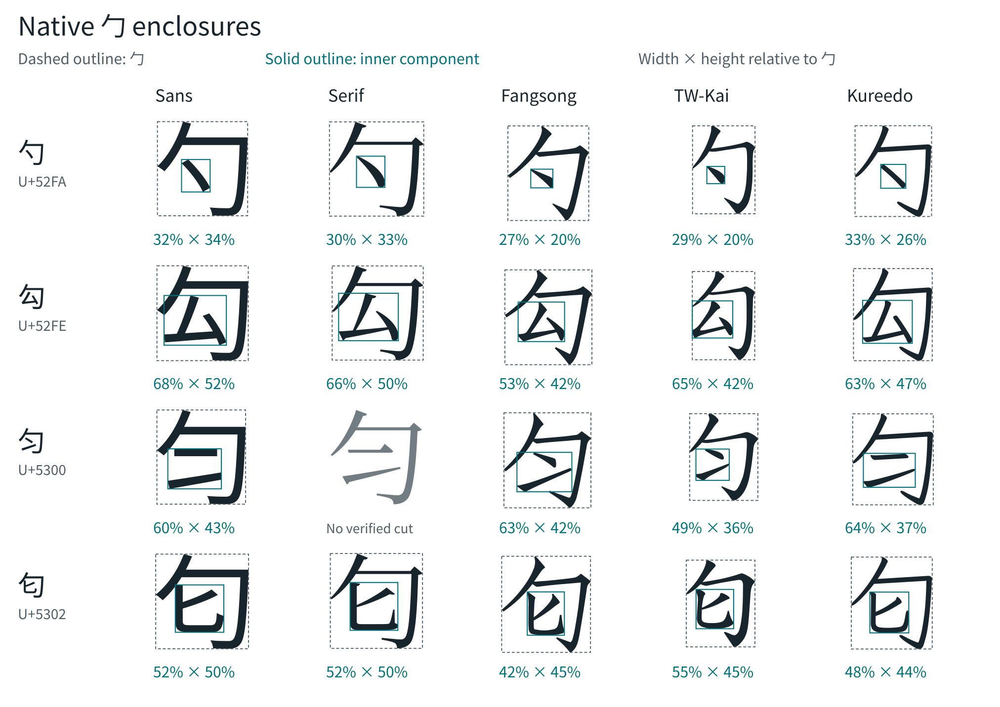
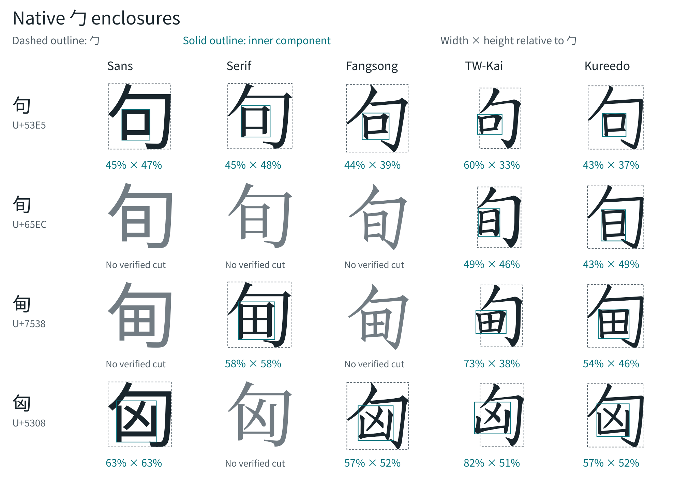
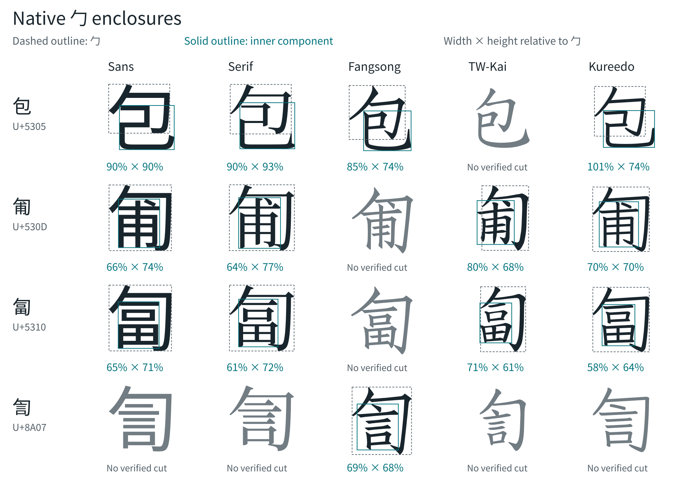

# Native ink boxes inside 勹

Across the five faces, the dot in 勺 occupies 27–33% of the enclosing 勹’s width. In Kureedo, the inner component of 包 extends past 勹 and reaches 100.7% of its width. Both values describe the visible ink, including the hook tip.

| Face | Measured forms | Inner width | Inner height | Center from left | Center from top |
|---|---:|---|---|---|---|
| Sans | 9 | 勺 31.7% – 包 89.7% | 勺 34.5% – 包 90.1% | 勾 41.9% – 包 62.5% | 勺 57.5% – 包 88.4% |
| Serif | 8 | 勺 30.1% – 包 89.8% | 勺 33.1% – 包 93.1% | 勾 39.9% – 包 60.8% | 勺 53.0% – 包 83.4% |
| Fangsong | 8 | 勺 27.3% – 包 84.8% | 勺 19.8% – 包 73.6% | 勾 41.9% – 包 68.2% | 勾 54.8% – 包 83.9% |
| TW-Kai | 10 | 勺 28.6% – 匈 82.2% | 勺 19.6% – 匍 67.9% | 句 24.4% – 匂 41.6% | 勾 54.3% – 句 60.0% |
| Kureedo | 11 | 勺 32.8% – 包 100.7% | 勺 26.2% – 包 74.1% | 勾 43.1% – 包 67.8% | 勺 55.8% – 包 85.5% |

Each endpoint names the glyph that sets it. The sample covers 46 character–face pairs among 12 characters with identifiable native contours. The catalogue contains 92 characters with at least one top-level ⿹勹 spelling, including regional variants of 勺. The measured 勺 uses the dot form. The CSV records the IDS used to partition each outline. For 包 the export label is ⿹勹己, and the catalogue also lists ⿹勹巳. [BabelStone IDS, Andrew West, 2025-06-27](../../data/vocab/han-ids.tsv)

## Native outlines

The dashed box follows 勹. The solid box follows the enclosed component.

<picture>
  <source media="(prefers-color-scheme: dark)" srcset="https://github.com/mkpoli/han-compose/raw/pr-assets/pr-486/native-1-dark.png">
  
</picture>

<picture>
  <source media="(prefers-color-scheme: dark)" srcset="https://github.com/mkpoli/han-compose/raw/pr-assets/pr-486/native-2-dark.png">
  
</picture>

<picture>
  <source media="(prefers-color-scheme: dark)" srcset="https://github.com/mkpoli/han-compose/raw/pr-assets/pr-486/native-3-dark.png">
  
</picture>

## Reading the measurements

The CSV gives the four ink edges of 勹 and its inner component in 1000-em units, with y increasing downward. Subtract the frame’s left edge from the midpoint of the inner left and right edges, then divide by the frame width to obtain its horizontal center fraction. Measure the vertical center from the top edge in the same way. The width and height percentages use the corresponding frame dimensions. [Per-glyph measurements and contour indices](hook-ink-boxes.csv)

The Sans contours come from export `0bd3ee83a5e2` (Noto Sans CJK JP 2.004), TW-Kai from `c14ee5e08798` (CNS11643 BMP 11510.1), and the Serif, Fangsong and Kureedo contours from `b53713c2da0e` (Kureedo Full 0.5.0).

For 44 pairs the export assigns disjoint sets of contours to the two operands. In Noto Serif CJK JP 2.003 (weight 400), the dot of 勺 is contour 0 of the font outline. In Zhuque Fangsong 0.212, the 勹 of 訇 is contour 0 of the exported outline and the other six contours form 言. The CSV records zero-based indices in the indicated source. [Font editions and licences](../licensing.md)

Bounding boxes describe size and position. To check clearance at the left sweep or the hook tip, measure the distance between the actual stroke outlines.
