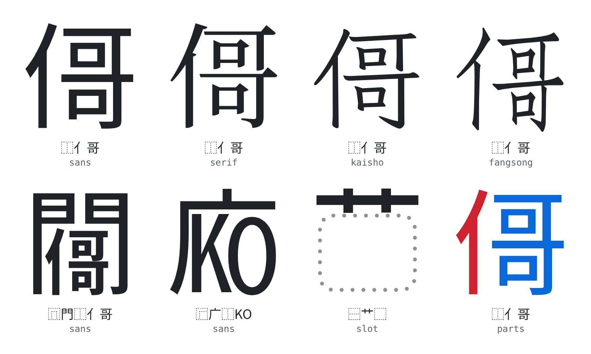

# @han-compose/composer

Draws a Han character from its ideographic description sequence (IDS), such as `⿰亻哥`, as an SVG
path. Each part is cut from a character a font already draws, set where the font's designers put
parts like it, and brought to one stroke weight, so a character with no code point comes out in the
font's own style. It runs in a browser, in a Web Worker, and in Node and Bun.

<picture>
  <source media="(prefers-color-scheme: dark)" srcset="https://raw.githubusercontent.com/mkpoli/han-compose/main/docs/images/composer-dark.png">
  
</picture>

## Install

```sh
npm install @han-compose/composer
```

ES modules with type declarations and no dependencies. Node needs 20.16 or later.

## Draw a sequence

The composer reads an *export*: a folder of static files holding one font style's parts and layout.
Four are public ([Exports](#exports)), and `compose` fetches only the files a sequence needs.

```js
import { writeFile } from 'node:fs/promises'
import { compose, drawingSvg, fromUrl } from '@han-compose/composer'

const source = fromUrl('https://ids-input-composer.mkpoli.workers.dev/a83fc941166b-sans-compose-layout-v4-f6+variants/')

const drawing = await compose(source, '⿰亻哥')
await writeFile('out.svg', drawingSvg(drawing))
```

One source serves any number of sequences and keeps what it has loaded.

## Exports

| Style | `fontStyle` | Fonts | Export |
|---|---|---|---|
| Sans | `'sans'` | Noto Sans CJK JP, Plangothic | `https://ids-input-composer.mkpoli.workers.dev/a83fc941166b-sans-compose-layout-v4-f6+variants/` |
| Serif (明朝) | `'serif'` | Noto Serif CJK JP, Jigmo | `https://ids-input-composer.mkpoli.workers.dev/8156f838798c-serif-compose-layout-v4-serif-f6+variants/` |
| Kaisho (楷書) | `'kaisho'` | Kureedo Full, GenZui Sans | `https://ids-input-composer.mkpoli.workers.dev/ce3eaafda8f9-kaisho-compose-layout-v4-kaisho-f6/` |
| Fangsong (仿宋) | `'fangsong'` | Zhuque Fangsong, Jigmo | `https://ids-input-composer.mkpoli.workers.dev/9f797e2322d2-fangsong-compose-layout-v4-fangsong-f6/` |

Pass the export's style with it:

```js
const serif = fromUrl('https://ids-input-composer.mkpoli.workers.dev/8156f838798c-serif-compose-layout-v4-serif-f6+variants/')
const drawing = await compose(serif, '⿰亻哥', { fontStyle: 'serif' })
```

An export's files never change under its URL. `export-web` in the
[repository](https://github.com/mkpoli/han-compose#run) writes an export from the fonts, to serve
from any static host.

## The drawing

`compose` answers a plain object in a 1000-unit box, y down.

| Field | |
|---|---|
| `d` | The SVG path of the ink, nonzero fill. |
| `parts` | Each drawn part: its path `d`, its `box` as `[x, y, width, height]`, and its `origin` (`learned 倡`, `glyph 口`). |
| `slots` | Each empty slot (`⬚`), in reading order, with its `box`. |
| `cut` | The path of what `㇯` takes away, masked out of `d`. |
| `stroke` | The stroke widths the drawing is weighted to, across x and y. |
| `kanjivg` | `true` when a part was cut along KanjiVG's component groups. The drawing is then CC BY-SA 3.0. |
| `approximate` | The operators drawn by an approximate rule: `⿼ ⿽ ⿾ ⿿ ㇯ 〾`. |

`drawingSvg(drawing, { ink, background, padding, size, placeholders, idPrefix })` writes the whole
drawing as an SVG. The parts are paths of their own when a page styles them:

```js
const drawing = await compose(source, '⿰亻哥', { separate: true })
const colours = ['#cf222e', '#0969da']
const svg = `<svg xmlns="http://www.w3.org/2000/svg" viewBox="0 0 1000 1000">${
  drawing.parts.map((part, i) => `<path d="${part.d}" fill="${colours[i % 2]}"/>`).join('')
}</svg>`
```

`separate` draws each operand as a piece even where one glyph spells the whole description, and
`exclude: ['侮']` names characters nothing may be taken from.

## What a sequence may hold

| | |
|---|---|
| `⿰亻哥` `⿵門⿰亻哥` | The operators `⿰ ⿱ ⿲ ⿳ ⿴ ⿵ ⿶ ⿷ ⿸ ⿹ ⿺ ⿻`, nested to 8 levels and 24 nodes. |
| `⿼叵口` `⿾可` `㇯口丨` | `⿼ ⿽`, the reflection `⿾`, the half-turn `⿿`, the subtraction `㇯` and `〾`. |
| `⿱艹⬚` | `⬚` (U+2B1A), an empty slot: the layout keeps its room and reports its box. |
| `⿸广⿰KO` | Letters and digits of Latin, Greek, Cyrillic, kana and Hangul as parts. |
| `⿰ㄱㅏ` | Hangul letters, drawn as the syllable they spell. |
| `者󠄁` | A variation sequence, drawn as the glyph the export's font maps it to. |

## In a page

`composerPreview` draws in a module Worker, one sequence at a time. A newer request ends the one
before it, whose promise rejects with an `AbortError`.

```js
import { composerPreview, drawingSvg } from '@han-compose/composer'

const preview = composerPreview({
  base: 'https://ids-input-composer.mkpoli.workers.dev/a83fc941166b-sans-compose-layout-v4-f6+variants/',
})
preview.warm() // start the Worker and read the export before the first drawing

input.addEventListener('input', async () => {
  try {
    const drawing = await preview(input.value)
    output.innerHTML = drawingSvg(drawing, { size: 200 })
  } catch (error) {
    if (error.name !== 'AbortError') status.textContent = error.message
  }
})
```

`preview(sequence, { signal, onSketch })` takes an `AbortSignal`, and `onSketch` hears each leaf's
box as soon as the layout is known. A sequence still being written (`⿰亻`) draws with an empty slot
where the missing part goes, and an Emoji part (`⿰👩木`) comes back in `drawing.emoji` with the box
to draw it in as text.

Vite builds the Worker as it stands. The outlines the package draws [without an
export](#without-an-export) are files under its `data/`: a bundled page serves that folder and names
each file's URL.

```js
// after copying node_modules/@han-compose/composer/data to public/composer-data
import { composerPreview, dataUrls } from '@han-compose/composer'

const preview = composerPreview({
  base,
  loaders: Object.fromEntries(Object.keys(dataUrls).map(path => [path, `/composer-data/${path}`])),
})
```

## Without an export

The package carries outlines for Tangut, Jurchen, Shuishu, Small Seal, Bopomofo and the New Korean
Orthography letters, and fallback glyphs from the Noto fonts for other scripts. `sourceFor` picks the
source a sequence draws from: the package's own outlines where they cover it, the export at `base`
otherwise.

```js
import { compose, drawingSvg } from '@han-compose/composer'
import { sourceFor } from '@han-compose/composer/source'

const tangut = await compose(sourceFor('𗀀', { bundled: true }), '𗀀') // no network
const mixed = await compose(sourceFor('⿰𗀀哥', { base }), '⿰𗀀哥')      // Tangut from the package, 哥 from the export
```

## Errors

`compose` throws a `LookupError` whose message says what could not be drawn.

```js
import { LookupError } from '@han-compose/composer'

try {
  await compose(source, '⿰亻')
} catch (error) {
  if (error instanceof LookupError) console.log(error.message) // ⿰亻 is missing a component.
}
```

`composerPreview` rejects with a `LookupError` too, with a `TooLargeError` for a sequence past the
limits, and with an `UnavailableError` when the export cannot be read.

## Reading a sequence

```js
import { parseDescription, writeDescription, tokens } from '@han-compose/composer'

parseDescription('⿰亻⿱七木')
// { op: '⿰', parts: ['亻', { op: '⿱', parts: ['七', '木'] }] }

writeDescription({ op: '⿰', parts: ['亻', { op: '⿱', parts: ['七', '木'] }] })
// '⿰亻⿱七木'

tokens('⿰亻⿱七木')[2]
// { path: [1], start: 2, end: 5, tokenEnd: 3, text: '⿱' }
```

## Entry points

| Import | |
|---|---|
| `@han-compose/composer` | `compose`, `fromUrl`, `composerPreview`, `drawingSvg`, the tree and token readers, the error classes |
| `/source` | `sourceFor`: the source a sequence draws from |
| `/loader` | Reading an export: `fromUrl`, `createSource`, `compose`, `sketch`, `LIMITS` |
| `/worker` | The module the Worker runs |
| `/variants` | `variationSequences(base)`: the variation sequences an export draws |
| `/drawing-svg`, `/document-source`, `/document-view` | A drawing as an SVG file, and as the layers of a document |
| `/tangut`, `/jurchen`, `/shuishu`, `/small-seal`, `/bopomofo`, `/new-korean`, `/unicode`, `/palette` | One source for each set of bundled outlines |
| `/src/<name>.js` | Every other module of the engine |

## Develop

```sh
bun install
bun run check                 # the types the declarations are made from
bun test tests                # the engine, its loader, the Worker, the bundled outlines
bun examples/draw-to-svg.js https://ids-input-composer.mkpoli.workers.dev/a83fc941166b-sans-compose-layout-v4-f6+variants/ '⿰木口' > out.svg
bun examples/bundled-script.js '𗀀' > tangut.svg
COMPOSER_EXPORT=~/exports/serif bun run parity:check   # against the Python composer's drawings
```

The package reads export format 6. The method, its measurements and the export's layout are in the
[repository](https://github.com/mkpoli/han-compose).

## Licence

MIT. The fonts and tables behind an export keep their own terms, which its `manifest.json` lists
under `licences`; the texts for the bundled outlines are in `data/licences`. A drawing with
`kanjivg: true` adapts [KanjiVG](https://kanjivg.tagaini.net/) (© Ulrich Apel, CC BY-SA 3.0) and is
shared alike with that notice.
