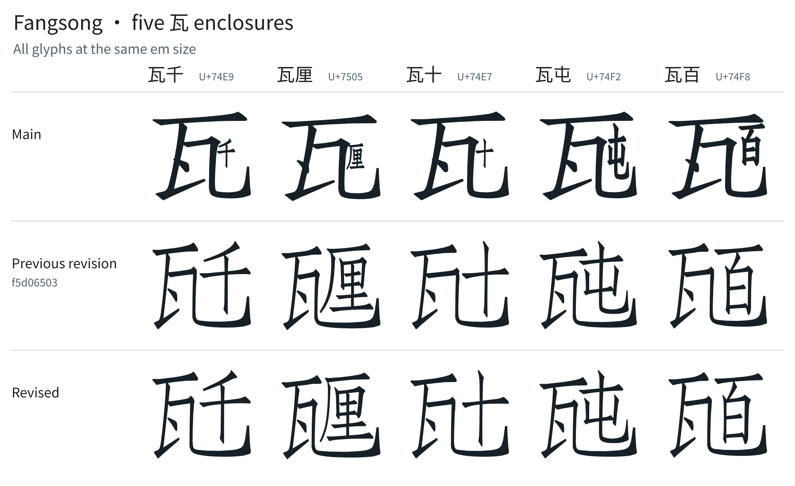
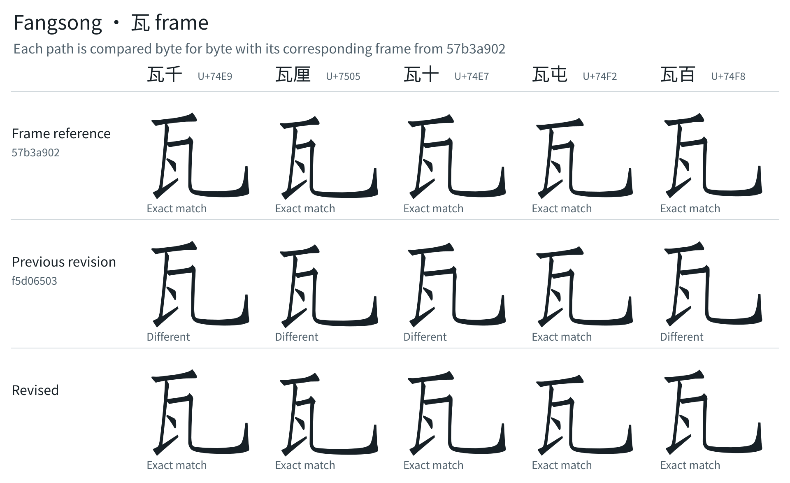

# Fangsong 瓦 enclosures

Main 1ca90e3e · Previous revision f5d06503 · Revised 05e9aacd.

| Comparison | Light | Dark |
| --- | --- | --- |
| Five Fangsong enclosures | [Light](overview-light.png) | [Dark](overview-dark.png) |
| 瓦 frame path against 57b3a902 | [Light](fixed-frames-light.png) | [Dark](fixed-frames-dark.png) |
| Encoded font and inner positions | [Light](inner-shapes-light.png) | [Dark](inner-shapes-dark.png) |
| Five-face comparison | [Light](five-faces-light.png) | [Dark](five-faces-dark.png) |

## Measurements and sources

- [Frame identity, inner bounds and clearances](frame-checks.csv)
- [Download gallery](gallery.zip)
- [Zhuque Fangsong 0.212](https://github.com/TrionesType/zhuque/releases/tag/v0.212)
- [Beijing ZhongYi FangSong](https://learn.microsoft.com/en-us/typography/font-list/fangsong)
