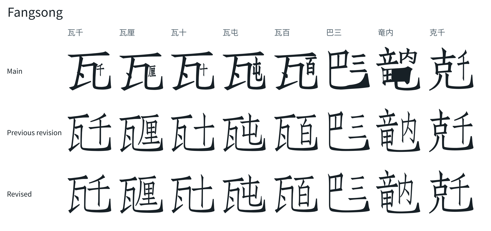
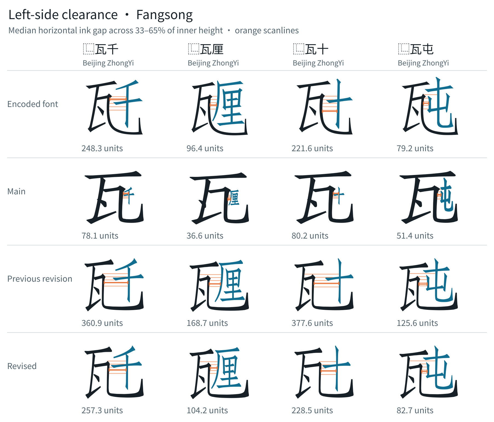

# Lower-left enclosure comparisons

Main 21e6b487 · Previous revision a74d7d6d · Revised 57b3a902.

| Comparison | Light | Dark |
| --- | --- | --- |
| Fangsong overview | [Light](overview-light.png) | [Dark](overview-dark.png) |
| Left-side clearance in 瓩、甅、瓧、瓲 | [Light](left-clearance-light.png) | [Dark](left-clearance-dark.png) |
| Left-side clearance in 瓸、𠀧、𥪞、兛 | [Light](left-clearance-b-light.png) | [Dark](left-clearance-b-dark.png) |
| Floor clearance in five 瓦 characters | [Light](floor-clearance-light.png) | [Dark](floor-clearance-dark.png) |
| Eight lower-left enclosures | [Light](fangsong-revisions-light.png) | [Dark](fangsong-revisions-dark.png) |
| 瓦 inner placement | [Light](tile-centers-light.png) | [Dark](tile-centers-dark.png) |
| 巴、竜、克 inner placement | [Light](inner-centers-light.png) | [Dark](inner-centers-dark.png) |
| WenJin Mincho and Jigmo encoded references | [Light](cross-style-light.png) | [Dark](cross-style-dark.png) |
| Beijing ZhongYi FangSong · six encoded characters | [Light](windows-fangsong-light.png) | [Dark](windows-fangsong-dark.png) |
| Zhuque Fangsong and cwTeX Q Fangsong | [Light](native-donors-light.png) | [Dark](native-donors-dark.png) |
| Five faces · 瓦千、瓦厘、瓦十 | [Light](five-faces-a-light.png) | [Dark](five-faces-a-dark.png) |
| Five faces · 瓦屯、瓦百、巴三 | [Light](five-faces-b-light.png) | [Dark](five-faces-b-dark.png) |
| Five faces · 竜内、克千 | [Light](five-faces-c-light.png) | [Dark](five-faces-c-dark.png) |

## Measurements and sources

- [Left-side clearance](left-clearance.csv)
- [Floor clearance](floor-clearance.csv)
- [Ink measurements](measurements.csv)
- [Version comparisons](revision-checks.csv)
- [Encoded-character checks](encoded-checks.csv)
- [Download gallery](gallery.zip)
- [Zhuque Fangsong 0.212](https://github.com/TrionesType/zhuque/releases/tag/v0.212)
- [Beijing ZhongYi FangSong](https://learn.microsoft.com/en-us/typography/font-list/fangsong)
- [cwTeX Q Fangsong](https://github.com/l10n-tw/cwtex-q-fonts/blob/e041d6df40ec81a7474f2b7d027379e64b84da5e/sfd/cwTeXQFangsong-Medium.sfd)
- [WenJin Mincho P2 · 2.101](https://github.com/takushun-wu/WenJinMincho)
- [Jigmo 2 · 2025-09-12](https://kamichikoichi.github.io/jigmo/)
