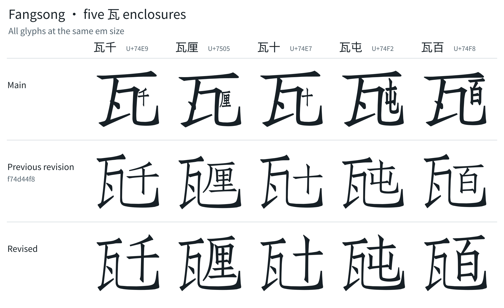
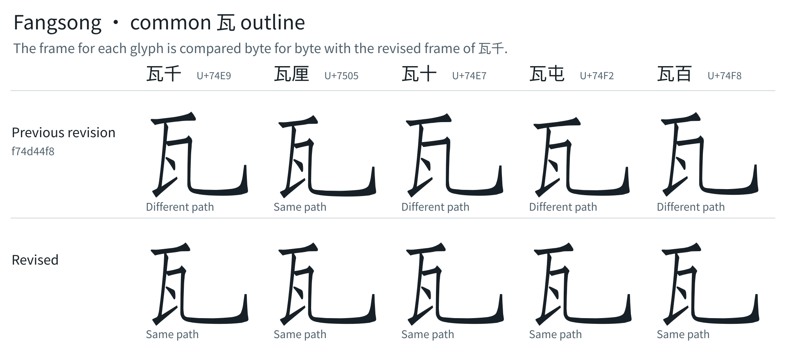

# Fangsong · common 瓦 and filling height

Main d59a3d35 · Previous revision f74d44f8 · Revised 4a2936dd.

| Comparison | Light | Dark |
| --- | --- | --- |
| Five Fangsong enclosures | [Light](overview-light.png) | [Dark](overview-dark.png) |
| Common 瓦 outline | [Light](common-frame-light.png) | [Dark](common-frame-dark.png) |
| Height of all five fillings | [Light](filling-heights-light.png) | [Dark](filling-heights-dark.png) |
| Contextual donors and extracted strokes | [Light](native-hosts-light.png) | [Dark](native-hosts-dark.png) |
| Five matched-scale native fillings | [Light](donor-shapes-light.png) | [Dark](donor-shapes-dark.png) |
| 厘 at matched scale | [Light](li-closeup-light.png) | [Dark](li-closeup-dark.png) |
| Five-face comparison | [Light](five-faces-light.png) | [Dark](five-faces-dark.png) |

## Measurements and sources

- [Donor contour measurements](donor-checks.csv)
- [Frame identity, inner bounds and clearances](frame-checks.csv)
- [Download gallery](gallery.zip)
- [Zhuque Fangsong 0.212](https://github.com/TrionesType/zhuque/releases/tag/v0.212)
- [Beijing ZhongYi FangSong](https://learn.microsoft.com/en-us/typography/font-list/fangsong)
