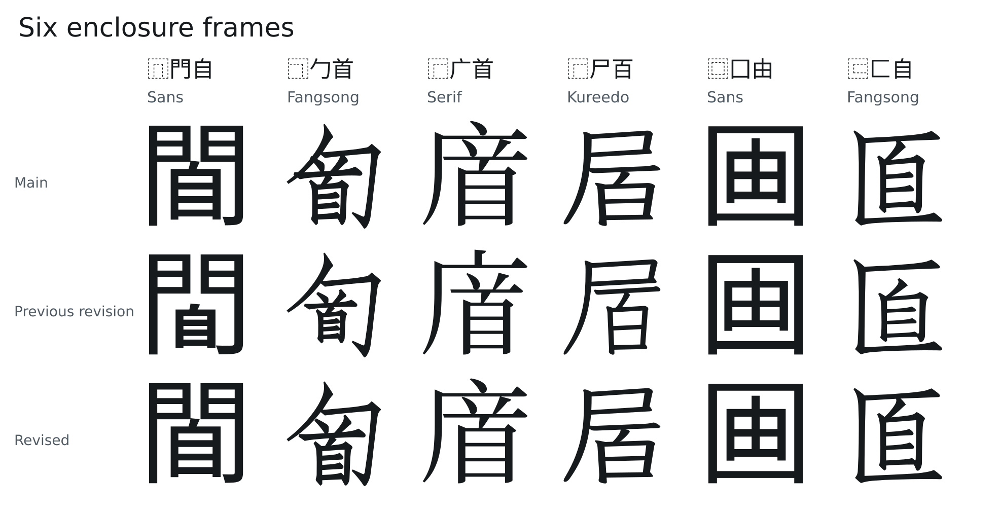
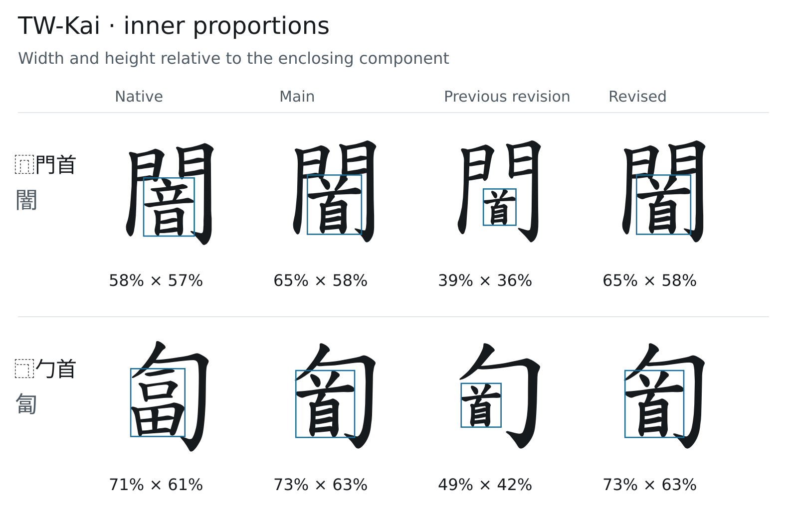
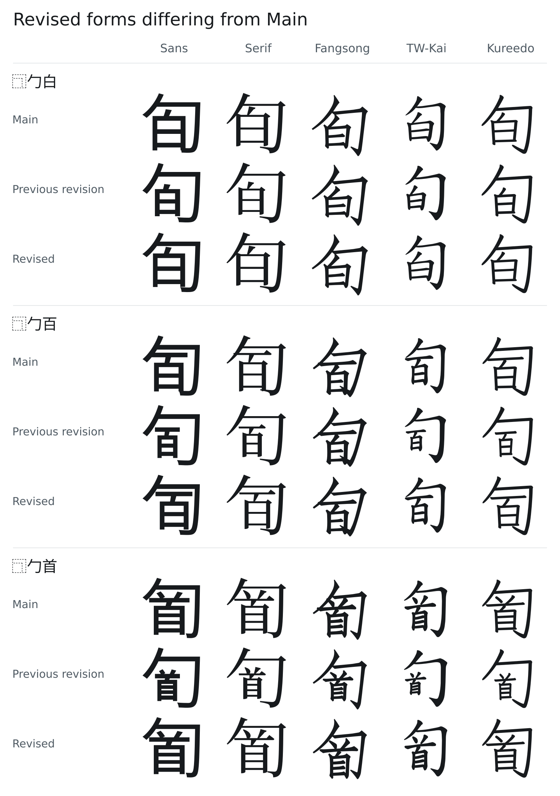
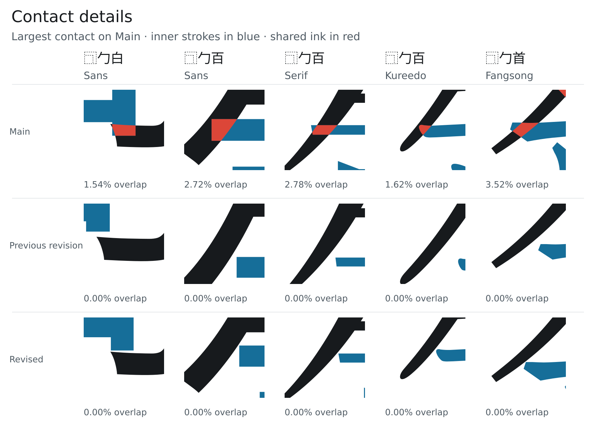

# Directional enclosure comparisons

Main f6f44f74 · Previous revision d8ee9f36 · Revised.

| Enclosure | Generated forms | Native outlines | Withheld characters |
| --- | --- | --- | --- |
| Top · 門 | [1](gate-versions-1-light.png) · [2](gate-versions-2-light.png) · [3](gate-versions-3-light.png) | [1](gate-native-1-light.png) · [2](gate-native-2-light.png) · [3](gate-native-3-light.png) | [1](gate-heldout-light.png) |
| Upper right · 勹 | [1](wrap-versions-1-light.png) · [2](wrap-versions-2-light.png) | [1](wrap-native-1-light.png) · [2](wrap-native-2-light.png) · [3](wrap-native-3-light.png) | [1](wrap-heldout-light.png) |
| Upper left · 广 | [1](shelter-versions-1-light.png) · [2](shelter-versions-2-light.png) · [3](shelter-versions-3-light.png) | [1](shelter-native-1-light.png) · [2](shelter-native-2-light.png) · [3](shelter-native-3-light.png) | [1](shelter-heldout-light.png) |
| Upper left · 尸 | [1](corpse-versions-1-light.png) · [2](corpse-versions-2-light.png) | [1](corpse-native-1-light.png) · [2](corpse-native-2-light.png) · [3](corpse-native-3-light.png) | [1](corpse-heldout-light.png) |
| Full · 囗 | [1](surround-versions-1-light.png) | [1](surround-native-1-light.png) · [2](surround-native-2-light.png) · [3](surround-native-3-light.png) | [1](surround-heldout-light.png) |
| Left · 匚 | [1](box-versions-1-light.png) · [2](box-versions-2-light.png) · [3](box-versions-3-light.png) | [1](box-native-1-light.png) · [2](box-native-2-light.png) · [3](box-native-3-light.png) | [1](box-heldout-light.png) |

## Data

- [Rendering origins](revisions.csv)
- [Reference characters](native-references.csv)
- [Measured native proportions](native-size.csv)
- [Withheld-character origins](withheld.csv)
- [BabelStone IDS · Andrew West · 2025-06-27](https://github.com/mkpoli/han-compose/blob/f6f44f74/data/vocab/han-ids.tsv)
- [Font sources](https://github.com/mkpoli/han-compose/blob/f6f44f74/docs/licensing.md)
- [Download the complete gallery](comparisons.zip)
