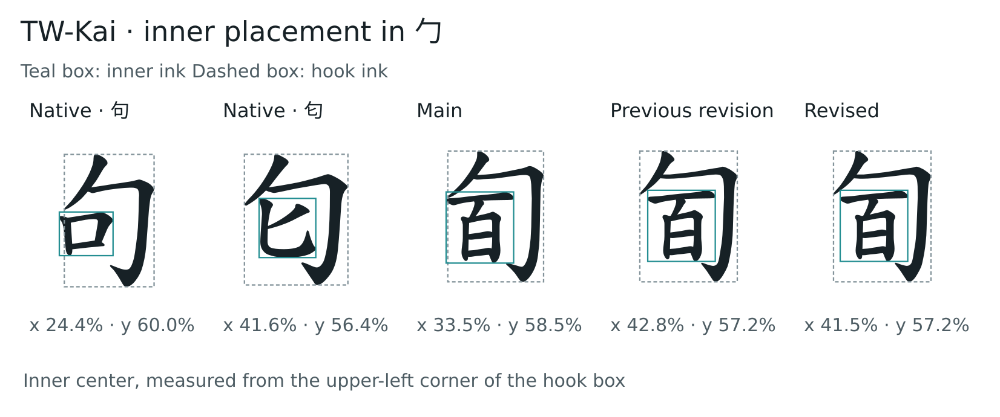
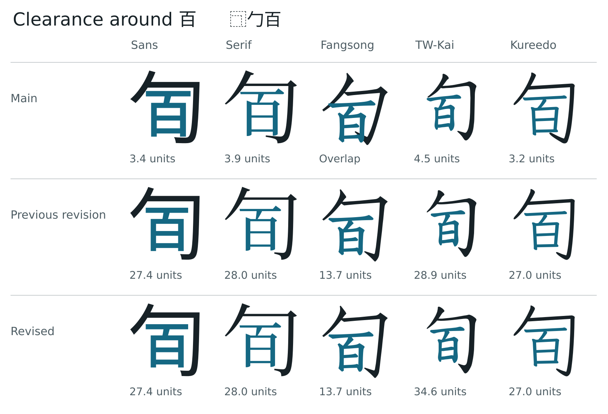
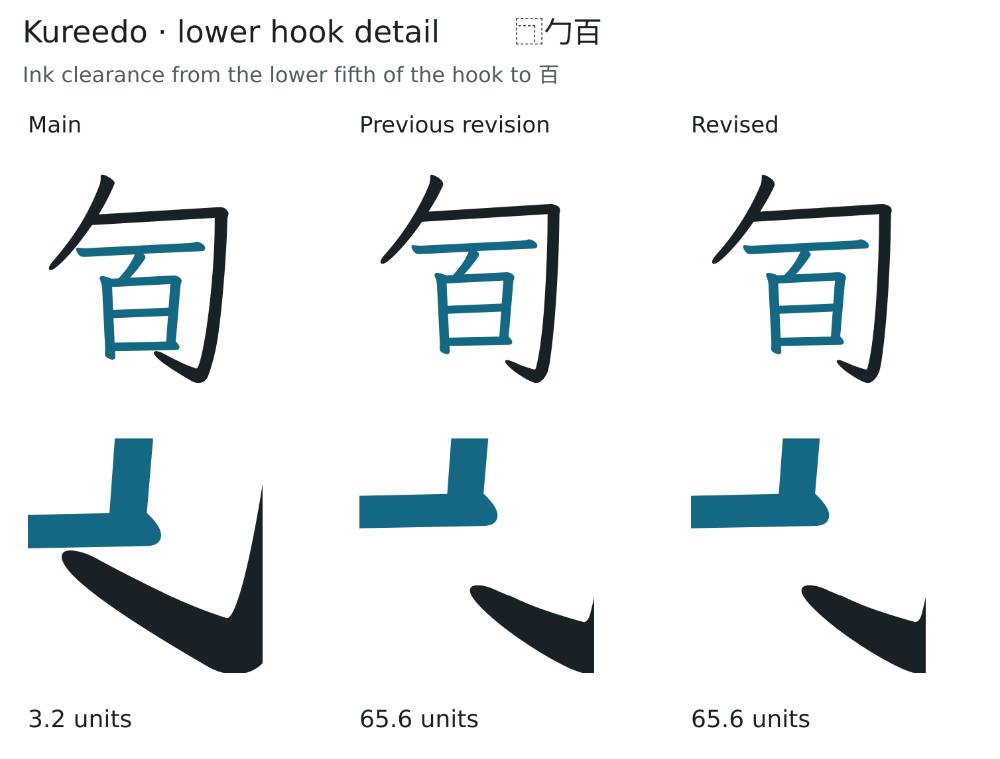

# 勹 enclosure comparisons

Main 74444cb3 · Previous revision 642add8b · Revised a9431b40.

## Regional IDS

| Character | Code | IDS | Regions |
| --- | --- | --- | --- |
| 勺 | U+52FA | [⿹勹丶](entry-001.svg) | GHTJPV |
| 勺 | U+52FA | [⿹勹一](entry-002.svg) | K |
| 勻 | U+52FB | [⿹勹二](entry-003.svg) | GHTJKP |
| 勼 | U+52FC | [⿹勹九](entry-004.svg) | GHTK |
| 勽 | U+52FD | [⿹勹人](entry-005.svg) | GT |
| 勾 | U+52FE | [⿹勹厶](entry-006.svg) | GHTJKPV |
| 勿 | U+52FF | [⿹勹⿰丿丿](entry-007.svg) | GHTJKPV |
| 匀 | U+5300 | [⿹勹冫](entry-008.svg) | GTJK |
| 匂 | U+5302 | [⿹勹匕](entry-009.svg) | GJK |
| 匃 | U+5303 | [⿹勹亾](entry-010.svg) | GTJKP |
| 匄 | U+5304 | [⿹勹亡](entry-011.svg) | GTP |
| 包 | U+5305 | [⿹勹巳](entry-012.svg) | GHTKPV |
| 包 | U+5305 | [⿹勹己](entry-013.svg) | J |
| 匇 | U+5307 | [⿹勹夕](entry-014.svg) | GTJ |
| 匈 | U+5308 | [⿹勹凶](entry-015.svg) | GHTJKPV |
| 匉 | U+5309 | [⿹勹平](entry-016.svg) | GHTKP |
| 匊 | U+530A | [⿹勹米](entry-017.svg) | GHTJKP |
| 匋 | U+530B | [⿹勹缶](entry-018.svg) | GHTJKP |
| 匌 | U+530C | [⿹勹合](entry-019.svg) | GTJKP |
| 匍 | U+530D | [⿹勹甫](entry-020.svg) | GHTJKPV |
| 匎 | U+530E | [⿹勹奄](entry-021.svg) | GHTK |
| 匐 | U+5310 | [⿹勹畐](entry-022.svg) | GHTJKPV |
| 匑 | U+5311 | [⿹勹躬](entry-023.svg) | GHTJKP |
| 匒 | U+5312 | [⿹勹荅](entry-024.svg) | GHTP |
| 匓 | U+5313 | [⿹勹⿰{18}殳](entry-025.svg) | G |
| 匓 | U+5313 | [⿹勹𣪘](entry-026.svg) | TJK |
| 匔 | U+5314 | [⿹勹躳](entry-027.svg) | GTK |
| 句 | U+53E5 | [⿹勹口](entry-028.svg) | GHTJKPV |
| 旬 | U+65EC | [⿹勹日](entry-029.svg) | GHTJKPV |
| 灳 | U+7073 | [⿹勹火](entry-030.svg) | GT |
| 甸 | U+7538 | [⿹勹田](entry-031.svg) | GHTJKP |
| 訇 | U+8A07 | [⿹勹言](entry-032.svg) | GHTJKP |
| 㔨 | U+3528 | [⿹勹背](entry-033.svg) | GT |
| 㔩 | U+3529 | [⿹勹盍](entry-034.svg) | GTKP |
| 㔪 | U+352A | [⿹勹鹵](entry-035.svg) | GT |
| 䀏 | U+400F | [⿹勹目](entry-036.svg) | GTKP |
| 𠣌 | U+208CC | [⿹勹𠂇](entry-037.svg) | T |
| 𠣍 | U+208CD | [⿹勹干](entry-038.svg) | GT |
| 𠣎 | U+208CE | [⿹勹幺](entry-039.svg) | GT |
| 𠣏 | U+208CF | [⿹勹{117}](entry-040.svg) | G |
| 𠣏 | U+208CF | [⿹勹止](entry-041.svg) | T |
| 𠣐 | U+208D0 | [⿹勹⿱丶丆](entry-042.svg) | G |
| 𠣐 | U+208D0 | [⿹勹⿱亠丿](entry-043.svg) | X |
| 𠣑 | U+208D1 | [⿹勹元](entry-044.svg) | GT |
| 𠣒 | U+208D2 | [⿹勹仁](entry-045.svg) | GT |
| 𠣓 | U+208D3 | [⿹勹云](entry-046.svg) | T |
| 𠣕 | U+208D5 | [⿹勹主](entry-047.svg) | GH |
| 𠣖 | U+208D6 | [⿹勹玄](entry-048.svg) | GT |
| 𠣗 | U+208D7 | [⿹勹去](entry-049.svg) | GT |
| 𠣘 | U+208D8 | [⿹勹舟](entry-050.svg) | GT |
| 𠣙 | U+208D9 | [⿹勹亘](entry-051.svg) | GT |
| 𠣚 | U+208DA | [⿹勹⿱二日](entry-052.svg) | GT |
| 𠣜 | U+208DC | [⿹勹虫](entry-053.svg) | TV |
| 𠣞 | U+208DE | [⿹勹車](entry-054.svg) | GT |
| 𠣟 | U+208DF | [⿹勹夋](entry-055.svg) | GT |
| 𠣠 | U+208E0 | [⿹勹⿱⺊𠕁](entry-056.svg) | GT |
| 𠣡 | U+208E1 | [⿹勹⿱八旦](entry-057.svg) | GT |
| 𠣤 | U+208E4 | [⿹勹⿱日兮](entry-058.svg) | GT |
| 𠣥 | U+208E5 | [⿹勹豖](entry-059.svg) | GT |
| 𠣦 | U+208E6 | [⿹勹炗](entry-060.svg) | GT |
| 𠣭 | U+208ED | [⿹勹咅](entry-061.svg) | G |
| 𠣮 | U+208EE | [⿹勹羍](entry-062.svg) | GTP |
| 𠣯 | U+208EF | [⿹勹苗](entry-063.svg) | GTV |
| 𠣰 | U+208F0 | [⿹勹者](entry-064.svg) | GTP |
| 𠣱 | U+208F1 | [⿹勹⿱⺊囬](entry-065.svg) | GT |
| 𠣲 | U+208F2 | [⿹勹⿱艹𠙽](entry-066.svg) | G |
| 𠣴 | U+208F4 | [⿹勹复](entry-067.svg) | GT |
| 𠣵 | U+208F5 | [⿹勹尃](entry-068.svg) | GT |
| 𠣸 | U+208F8 | [⿹勹𡕨](entry-069.svg) | GT |
| 𠣹 | U+208F9 | [⿹勹既](entry-070.svg) | GT |
| 𠣽 | U+208FD | [⿹勹敢](entry-071.svg) | GT |
| 𠣾 | U+208FE | [⿹勹復](entry-072.svg) | GT |
| 𠣿 | U+208FF | [⿹勹㲃](entry-073.svg) | GT |
| 𠤂 | U+20902 | [⿹勹⿰身⿱二弓](entry-074.svg) | G |
| 𠤄 | U+20904 | [⿹勹⿱𥫗幸](entry-075.svg) | GT |
| 𠤅 | U+20905 | [⿹勹蓋](entry-076.svg) | GT |
| 𠤇 | U+20907 | [⿹勹𢕒](entry-077.svg) | GT |
| 𠤈 | U+20908 | [⿹勹⿱⿲人人人⿲个个个](entry-078.svg) | GT |
| 𠤊 | U+2090A | [⿹勹窮](entry-079.svg) | GT |
| 𠤋 | U+2090B | [⿹勹蟲](entry-080.svg) | GT |
| 𠤍 | U+2090D | [⿹勹雚](entry-081.svg) | G |
| 𧍀 | U+27340 | [⿹勹䖵](entry-082.svg) | G |
| 𧥻 | U+2797B | [⿹勹⿱二言](entry-083.svg) | GT |
| 𫧀 | U+2B9C0 | [⿹勹土](entry-084.svg) | G |
| 𫧁 | U+2B9C1 | [⿹勹⿲丨丨丨](entry-085.svg) | G |
| 𫧄 | U+2B9C4 | [⿹勹朕](entry-086.svg) | G |
| 𫧅 | U+2B9C5 | [⿹勹䋣](entry-087.svg) | G |
| 𫧆 | U+2B9C6 | [⿹勹⿱庚糸](entry-088.svg) | G |
| 𭅄 | U+2D144 | [⿹勹又](entry-089.svg) | S |
| 𭅅 | U+2D145 | [⿹勹⿺𠃊又](entry-090.svg) | J |
| 𭅆 | U+2D146 | [⿹勹井](entry-091.svg) | S |
| 𭅇 | U+2D147 | [⿹勹占](entry-092.svg) | S |
| 𭅈 | U+2D148 | [⿹勹市](entry-093.svg) | S |
| 𭅊 | U+2D14A | [⿹勹⿱䒑{117}](entry-094.svg) | J |
| 𭅋 | U+2D14B | [⿹勹豆](entry-095.svg) | K |
| 𰅛 | U+3015B | [⿹勹八](entry-096.svg) | S |
| 𱑁 | U+31441 | [⿹勹熏](entry-097.svg) | B |

## Additional generated forms

- [⿹勹百](extra-1.svg)
- [⿹勹首](extra-2.svg)
- [⿹勹白](extra-3.svg)
- [⿹勹自](extra-4.svg)

## Source outlines

- [U+52FA – U+5302](native-1-light.png)
- [U+5303 – U+530B](native-2-light.png)
- [U+530C – U+5314](native-3-light.png)
- [U+53E5 – U+352A](native-4-light.png)
- [U+400F – U+208D2](native-5-light.png)
- [U+208D3 – U+208DC](native-6-light.png)
- [U+208DE – U+208ED](native-7-light.png)
- [U+208EE – U+208F8](native-8-light.png)
- [U+208F9 – U+20907](native-9-light.png)
- [U+20908 – U+2B9C1](native-10-light.png)
- [U+2B9C4 – U+2D148](native-11-light.png)
- [U+2D14A – U+31441](native-12-light.png)

## Data and sources

- [Measured native ranges](ink-box-ranges.md)
- [Ink boxes and source ranges](box-measurements.csv)
- [All three inner centers](box-centers.csv)
- [Additional rendering checks](render-checks.csv)
- [Font coverage](font-coverage.csv)
- [Rendered forms and failures](renderings.csv)
- [Native component measurements](native-seats.csv)
- [百 clearance](bai-clearance.csv)
- [171 nested characters · native outlines](nested-references.pdf)
- [Nested font coverage](nested-coverage.csv)
- [Download gallery](gallery.zip)
- [Pinned IDS catalogue](https://github.com/mkpoli/han-compose/blob/74444cb3/data/vocab/han-ids.tsv)
- [Font sources and licenses](https://github.com/mkpoli/han-compose/blob/74444cb3/docs/licensing.md)
