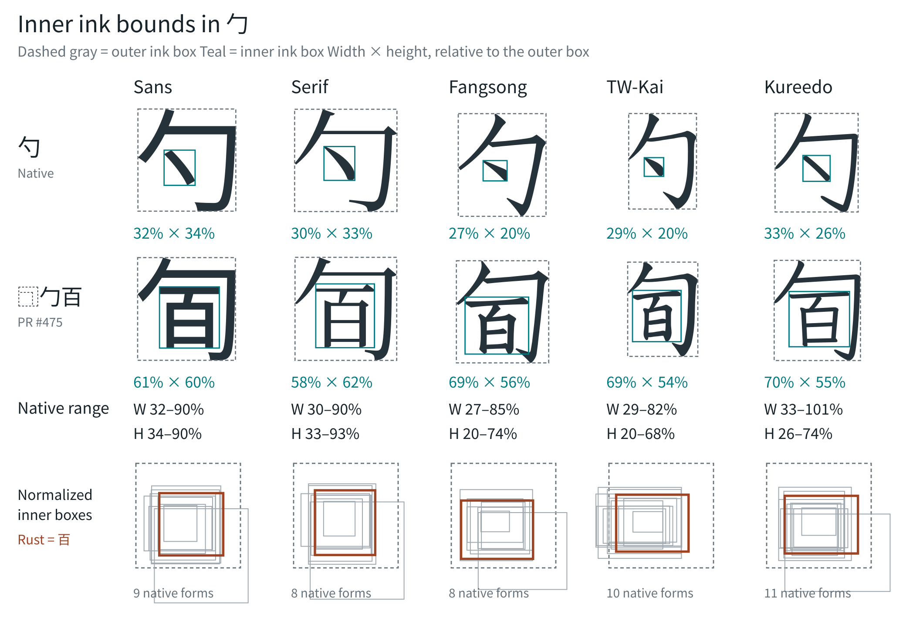
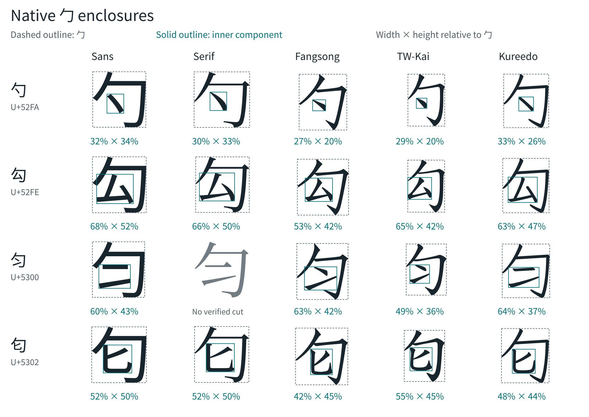
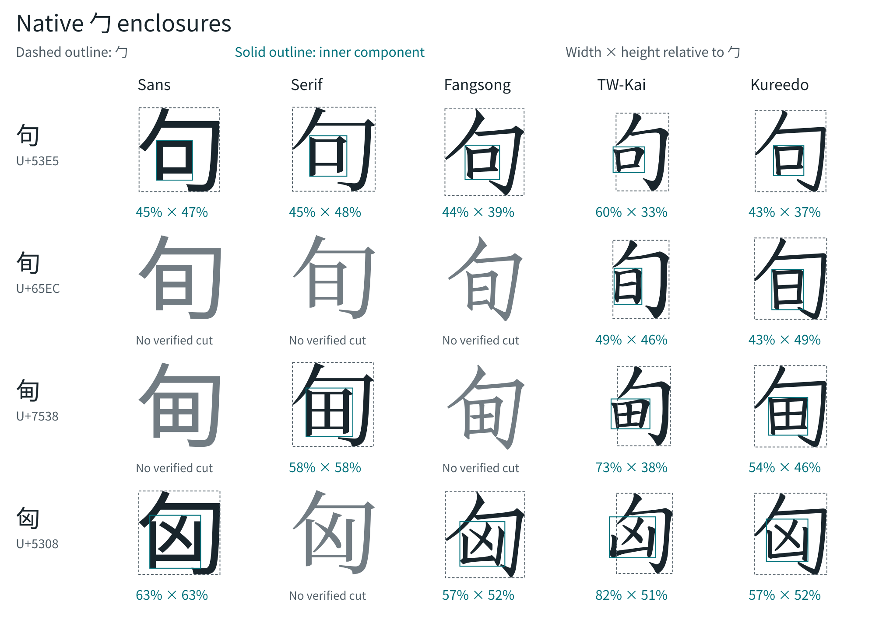
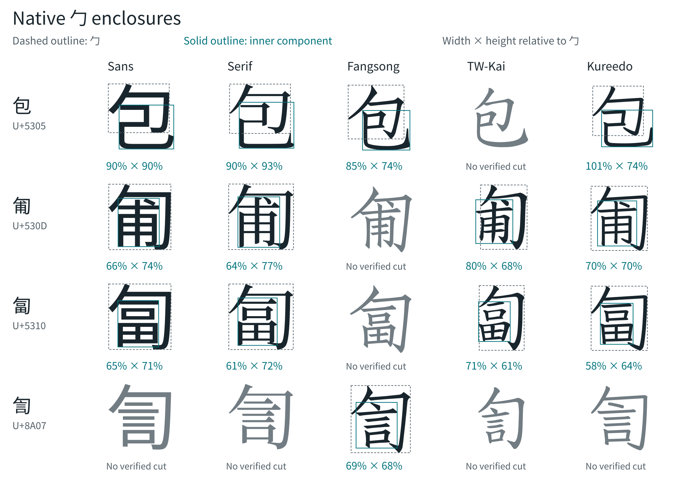

# Bounding boxes inside 勹

## Measured limits

Each endpoint names the native character that sets it. Coordinates start at the upper-left of the 勹 ink box. An inner stroke may extend beyond that box.

| Face | Inner width | Inner height | Center from left | Center from top |
|---|---|---|---|---|
| Sans | 勺 31.7% – 包 89.7% | 勺 34.5% – 包 90.1% | 勾 41.9% – 包 62.5% | 勺 57.5% – 包 88.4% |
| Serif | 勺 30.1% – 包 89.8% | 勺 33.1% – 包 93.1% | 勾 39.9% – 包 60.8% | 勺 53.0% – 包 83.4% |
| Fangsong | 勺 27.3% – 包 84.8% | 勺 19.8% – 包 73.6% | 勾 41.9% – 包 68.2% | 勾 54.8% – 包 83.9% |
| TW-Kai | 勺 28.6% – 匈 82.2% | 勺 19.6% – 匍 67.9% | 句 24.4% – 匂 41.6% | 勾 54.3% – 句 60.0% |
| Kureedo | 勺 32.8% – 包 100.7% | 勺 26.2% – 包 74.1% | 勾 43.1% – 包 67.8% | 勺 55.8% – 包 85.5% |

## Native comparisons

## Measurement data

[Download all box edges and centers (CSV)](box-measurements.csv) · [Scalable overview](box-overview-light.png)

The measured range covers 46 native character–face pairs from 12 characters in the [92-character 勹 inventory](https://github.com/mkpoli/han-compose/blob/pr-assets/pr-475/box-range/GALLERY.md). Forty-four cuts use the export’s component labels. The Serif 勺 dot is its isolated first contour, and the Fangsong 訇 hook uses the verified first contour. The 百 comparison uses the [current PR drawing](https://github.com/mkpoli/han-compose/commit/a9431b40e2e9).

Sources: [font sources and licensing](https://github.com/mkpoli/han-compose/blob/cda86dca/docs/licensing.md) · [BabelStone IDS, Andrew West, 2025-06-27](https://github.com/mkpoli/han-compose/blob/cda86dca/data/vocab/han-ids.tsv).
